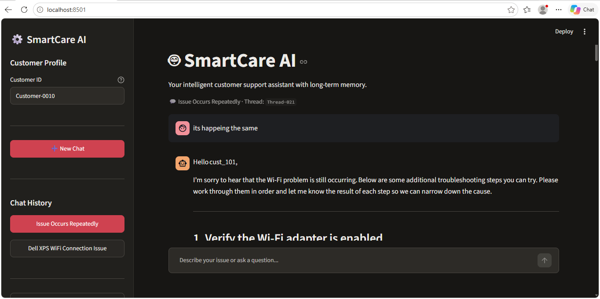
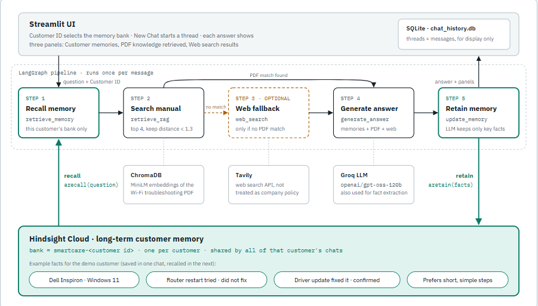
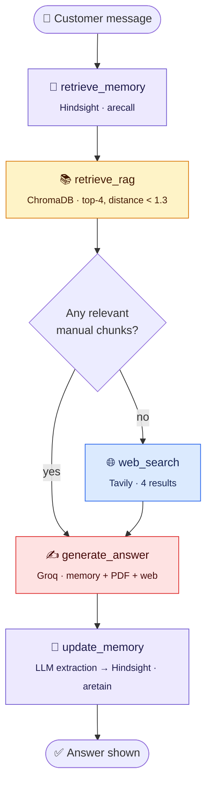
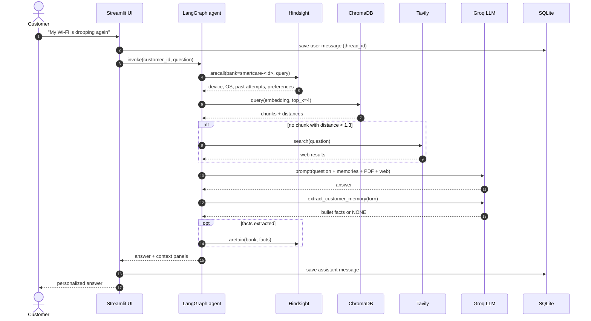
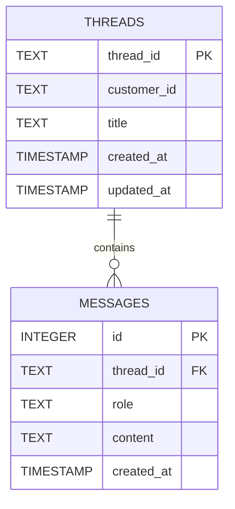

<div align="center">

# 🤖 SmartCare AI

### A customer support agent that remembers each customer

*It recalls what it knows about the customer before it reads the manual.*

[](https://www.python.org/)
[](https://streamlit.io/)
[](https://github.com/langchain-ai/langgraph)
[](https://hindsight.vectorize.io/)
[](https://groq.com/)
[](https://www.trychroma.com/)
[](https://tavily.com/)

[Overview](#-overview) •
[Architecture](#-architecture) •
[How Memory Works](#-how-hindsight-memory-works) •
[Quick Start](#-quick-start) •
[Demo](#-demo-walkthrough) •
[Design Decisions](#-design-decisions) •
[Limitations](#-known-limitations)



</div>

---

## 📌 Overview

Most support bots forget everything between sessions. Every time a customer comes back, they have to explain their device, their OS, their symptoms and what they've already tried.

**SmartCare AI** gives each customer a **long-term memory bank** in [Hindsight](https://hindsight.vectorize.io/). On every turn the agent:

1. **Recalls** what it already knows about this customer.
2. **Retrieves** the relevant sections of the company troubleshooting manual (RAG over ChromaDB).
3. **Falls back** to live web search (Tavily) only when the manual has nothing relevant.
4. **Generates** an answer grounded in memory, manual and web context (Groq LLM).
5. **Retains** a short list of facts from the turn (not the raw transcript) back into that customer's memory bank.

The result: a returning customer can type *"hii"* or *"it's happening again"*, and the agent already knows which laptop, which problem, what has failed before and how the customer likes instructions written.

### ✨ Key features

| | Feature | Description |
|---|---|---|
| 🧠 | **Per-customer long-term memory** | One isolated Hindsight bank per customer, shared across all of that customer's chat threads |
| 🧪 | **Distilled memory writes** | An LLM extraction step stores issues, environment, attempted and confirmed outcomes, and preferences, or nothing at all |
| 🚫 | **No false confirmations** | Prompts keep *suggested*, *attempted* and *confirmed-fixed* separate, so the agent never treats its own guesses as history |
| 📚 | **Knowledge-base RAG** | PDF manual chunked, embedded with `all-MiniLM-L6-v2` and searched in ChromaDB, with page-level citations |
| 🌐 | **Web-search fallback** | Tavily search runs only when no manual chunk passes the relevance threshold |
| 🔀 | **Explicit agent graph** | LangGraph `StateGraph` with a conditional route after retrieval |
| 💬 | **Multi-thread chat history** | ChatGPT-style threads per customer, persisted in SQLite, with auto-generated titles |
| 🔍 | **Transparent reasoning** | Each answer shows expandable panels for recalled memories, retrieved PDF sections and web results |
| 🛡️ | **Graceful degradation** | If Hindsight, Chroma or Tavily is down, the agent answers with reduced context instead of crashing |

---

## 🏗 Architecture

<div align="center">

</div>

### Agent graph



The graph is wired in [`src/agent/graph.py`](src/agent/graph.py). The node logic is in [`src/agent/nodes.py`](src/agent/nodes.py), and the shared state schema is in [`src/agent/state.py`](src/agent/state.py):

```python
class SupportState(TypedDict, total=False):
    customer_id: str
    question: str
    memories: List[str]              # recalled from Hindsight
    documents: List[Dict[str, Any]]  # relevant manual chunks
    web_results: List[Dict[str, Any]]
    use_web: bool                    # set by retrieve_rag
    answer: str
    new_memory: str                  # what was retained this turn
```

### Request lifecycle



### Two stores, two jobs

| Store | What it holds | Scope | Lifecycle |
|---|---|---|---|
| **Hindsight** | Short facts about the customer (environment, issues, outcomes, preferences) | Per **customer** | Added to after every useful turn |
| **ChromaDB** | Chunks of the troubleshooting manual | Global | Rebuilt when the PDF changes |
| **SQLite** | Full chat transcripts and thread metadata | Per **thread** | Appended to every message |

> **Rule of thumb:** Facts that apply to every customer go in ChromaDB. Facts about one customer go in Hindsight. Full transcripts go in SQLite.

---

## 🧠 How Hindsight memory works

Here is each step in detail.

### 1. One bank per customer

[`get_bank_id()`](src/memory/hindsight_memory.py) turns a free-text customer ID into a stable, sanitized bank ID:

```python
def get_bank_id(customer_id):
    safe_id = "".join(
        c if c.isalnum() or c in "-_" else "-"
        for c in customer_id.lower()
    )
    return f"smartcare-{safe_id[:50]}"
```

On first contact, `client.acreate_bank(...)` creates the bank with a background description that tells Hindsight what to keep: the customer's environment, recurring issues, preferences and confirmed troubleshooting outcomes. Each recall only reads that one customer's bank, so isolation comes from the bank layout, not from a filter someone could forget to apply.

### 2. Recall before answering

`retrieve_memory_node` is the **first** node in the graph. It calls `client.arecall(bank_id, query, budget="low")` and passes the matched facts to the LLM under the `CUSTOMER'S PREVIOUS MEMORIES` heading.

Memory runs before RAG because returning customers write vague messages. Only memory knows what *"my issue"* refers to, and only memory knows which steps in the manual the customer has already tried.

### 3. Retain facts, not transcripts

`update_memory_node` is the **last** node. It does not store the raw Q&A. It sends the turn through [`extract_customer_memory()`](src/llm.py), which pulls out:

- ✅ Customer issues and previous complaints
- ✅ Troubleshooting steps attempted, and failed solutions
- ✅ Solutions **the customer confirmed** worked
- ✅ Preferences, such as *"keep the steps short"*
- ✅ Unresolved problems

and skips greetings, generic AI advice, repeated information and unsupported assumptions. If nothing in the turn is worth keeping, the extractor returns `NONE` and **nothing is written**. A *"hii"* therefore doesn't add noise to the bank.

### 4. Never record a guess as a confirmed fix

Both the generation prompt and the extraction prompt say that a suggested fix must not be treated as working unless the customer said so. Each turn is also tagged before extraction:

```text
(Note: the customer has not confirmed whether any suggested troubleshooting step actually worked.)
```

Without this tag, the agent would later tell customers *"since we've already restarted the router…"* about steps it had only suggested.

### Memory in action

| Turn | Customer says | Memory recalled | What the agent does |
|---|---|---|---|
| 1 | *"My Dell Inspiron on Windows 11 keeps losing Wi-Fi during online classes. Keep it simple please."* | *(empty)* | Generic manual steps, cited by page. **Retains** device, OS, symptom and preference |
| 2 | *"Restarted the router, still drops."* | Device, OS, symptom | Moves on to the next steps. **Retains** "router restart, confirmed not to help" |
| 3 *(new thread, days later)* | *"hii"* | All of the above | Greets the customer and offers to continue with the Dell Wi-Fi issue in short steps |
| 4 | *"The driver update fixed it!"* | All of the above | **Retains** the confirmed fix, so *"what worked last time?"* gets a direct answer later |

---

## 🧰 Tech stack

| Layer | Technology | Where |
|---|---|---|
| UI | Streamlit | [`app.py`](app.py) |
| Agent orchestration | LangGraph `StateGraph` | [`src/agent/`](src/agent) |
| LLM | Groq (default `openai/gpt-oss-120b`, temperature 0.3) | [`src/agent/nodes.py`](src/agent/nodes.py), [`src/llm.py`](src/llm.py) |
| Long-term memory | Hindsight (`hindsight-client`, async) | [`src/memory/hindsight_memory.py`](src/memory/hindsight_memory.py) |
| Embeddings | `sentence-transformers` · `all-MiniLM-L6-v2` (normalized) | [`src/rag/`](src/rag) |
| Vector store | ChromaDB (persistent) | [`src/rag/ingest.py`](src/rag/ingest.py) |
| PDF parsing | PyMuPDF (`fitz`) | [`src/rag/ingest.py`](src/rag/ingest.py) |
| Web search | Tavily (`basic`, 4 results) | [`src/tools/tavily_search.py`](src/tools/tavily_search.py) |
| Chat history | SQLite (threads + messages) | [`src/history.py`](src/history.py) |

---

## 📁 Project structure

```text
Customer_chatbot_hindsight_memeory/
├── app.py                        # Streamlit UI: sidebar, threads, chat, context panels
├── requirements.txt
├── .env.example                  # Template for API keys
├── article.md                    # Write-up: "Why I recall Hindsight memory before running RAG"
├── assets/
│   ├── smartcare-architecture.png
│   └── smartcare-ui.png
├── data/
│   └── Customer_Support_Agent_Knowledge_Base.pdf   # Wi-Fi troubleshooting manual
├── database/                     # Generated at runtime (git-ignored)
│   ├── chroma_db/                # Persistent vector index
│   └── chat_history.db           # SQLite threads + messages
└── src/
    ├── config.py                 # Env loading, paths, required-key checks
    ├── llm.py                    # Groq helpers: chat titles, memory extraction
    ├── history.py                # SQLite threads/messages (+ legacy schema migration)
    ├── ingest_knowledge.py       # CLI: index every PDF in data/
    ├── agent/
    │   ├── state.py              # SupportState TypedDict
    │   ├── nodes.py              # retrieve_memory, retrieve_rag, web_search, generate_answer, update_memory
    │   └── graph.py              # LangGraph wiring + conditional routing
    ├── memory/
    │   └── hindsight_memory.py   # Bank IDs, recall, retain, background event loop
    ├── rag/
    │   ├── ingest.py             # Chunking (700 words / 100 overlap) + embedding + upsert
    │   └── retriever.py          # Top-k semantic search with distances
    └── tools/
        └── tavily_search.py      # Web search fallback
```

---

## 🚀 Quick start

### Prerequisites

- Python **3.10+**
- API keys for [Groq](https://console.groq.com/keys), [Hindsight](https://hindsight.vectorize.io/) and (optionally) [Tavily](https://app.tavily.com/)

### 1. Clone and install

```bash
git clone <your-repo-url> Customer_chatbot_hindsight_memeory
cd Customer_chatbot_hindsight_memeory

python -m venv venv
# Windows
venv\Scripts\activate
# macOS / Linux
source venv/bin/activate

pip install -r requirements.txt
```

> The first run downloads the `all-MiniLM-L6-v2` embedding model (~90 MB).

### 2. Configure environment

```bash
cp .env.example .env     # Windows: copy .env.example .env
```

| Variable | Required | Default | Purpose |
|---|:---:|---|---|
| `GROQ_API_KEY` | ✅ | — | LLM for answers, titles and memory extraction |
| `GROQ_MODEL` | | `openai/gpt-oss-120b` | Groq model ID |
| `HINDSIGHT_API_KEY` | ✅ | — | Long-term customer memory |
| `HINDSIGHT_BASE_URL` | | `https://api.hindsight.vectorize.io` | Hindsight endpoint |
| `TAVILY_API_KEY` | | — | Web fallback. If unset, web search returns no results |

> ⚠️ **Never commit `.env`.** It is already in `.gitignore`.

### 3. Index the knowledge base

Run this once, and again whenever you add or replace a PDF in `data/`:

```bash
python -m src.ingest_knowledge
```

Re-indexing a PDF deletes its old chunks first, so running the command twice doesn't create duplicates.

### 4. Launch

```bash
streamlit run app.py
```

Open http://localhost:8501, enter a **Customer ID** in the sidebar and start chatting.

---

## 🎬 Demo walkthrough

1. **First contact.** Set Customer ID `rajesh`. Describe a specific Wi-Fi problem (laptop model, OS, when it started). Open **📚 PDF knowledge retrieved** to see the matched manual section and page.
2. **Report an outcome.** Say *"I restarted the router, still dropping."* The next answer skips that step.
3. **Come back cold.** Click **➕ New Chat** (or reload the browser) and type just *"hii"* or *"any next step for my issue?"*. Open **🧠 Customer memories** to see what was recalled. The answer picks up where the last conversation stopped, and the customer didn't have to repeat anything.
4. **Show the difference.** Switch the Customer ID to `new-user` and send the same message. The bank is empty, so the agent asks diagnostic questions instead. The model, manual and prompt are the same; only the memory bank is different.
5. **Go off-script.** Ask something the manual doesn't cover. The **🌐 Web search results** panel shows the Tavily fallback, with source URLs in the answer.

---

## 🧭 Design decisions

<details>
<summary><b>Why recall memory <i>before</i> RAG?</b></summary>

<br/>

Returning customers write vague messages. *"Hi, I'm back. Any next step for my issue?"* scored a Chroma distance of about **1.53** against its best manual chunk, so it was rejected and sent to web search. Memory is what tells the agent what *"my issue"* means, and which manual steps the customer has already tried. See [`article.md`](article.md) for the full story.

</details>

<details>
<summary><b>Why is the RAG threshold <code>distance &lt; 1.3</code>?</b></summary>

<br/>

It was measured against the shipped manual. Clearly relevant queries scored their best chunk at about **0.94–1.18**, and unrelated queries scored above **1.45**. The first threshold, 1.0, rejected chunks that were relevant. If you swap in a different knowledge base, measure a few known queries again.

</details>

<details>
<summary><b>Why a separate memory system instead of a <code>customer_id</code> filter in Chroma?</b></summary>

<br/>

The manual and the customer facts change in different ways. The manual is rebuilt when the PDF changes. Customer facts are added after every turn, have to separate *confirmed* from *suggested*, and have to be scoped to one person. Hindsight's banks, `retain` and `recall` are built for that. A filter is also something a future query could forget to apply, while a separate bank per customer can't be skipped.

</details>

<details>
<summary><b>Why a background event loop for Hindsight?</b></summary>

<br/>

The Hindsight client is async, and Streamlit reruns the whole script on every interaction. Calling `asyncio.run` on each rerun left HTTP sessions tied to loops that had already closed. The fix is one long-lived event loop on a daemon thread. The client is created lazily on that loop, and every call goes through `run_coroutine_threadsafe`, so recall and retain behave like ordinary blocking functions inside the graph nodes.

</details>

<details>
<summary><b>How does it handle failures?</b></summary>

<br/>

| Failure | Behavior |
|---|---|
| Hindsight unreachable on recall | Empty memories; answers from the manual and web only |
| Hindsight unreachable on retain | Answer is still shown; the memory write is skipped |
| Chroma or embedding error | Treated as "no relevant docs", so it falls back to web search |
| Tavily down or no key | Empty web results; answers from what context remains |
| Chat-title generation fails | Falls back to a title made from the question |

</details>

---

## 🗄 Data model (SQLite)



A customer can have many threads, and all of them share **one** Hindsight memory bank. `initialize_database()` also migrates the old single-table schema (where `customer_id` doubled as the conversation ID) to this layout without losing any messages.

---

## ⚠️ Known limitations

- **No authentication.** `customer_id` is a free-text field, so anyone can type another customer's ID and see their threads and memory. This is fine for a demo with made-up data but not for production.
- **Recall latency.** A fact retained a moment ago is sometimes missed by the next recall, probably because Hindsight is still indexing it. Asking again a few seconds later usually finds it.
- **The threshold is tuned to one corpus.** The `1.3` distance cutoff fits the shipped PDF only.
- **The RAG query is just the raw message.** Recalled memories inform the answer, but they aren't yet used to rewrite the retrieval query.
- **No automated tests yet.**

## 🗺 Roadmap

- [ ] Rewrite the retrieval query using recalled memories (e.g. *"hii"* → *"Dell Inspiron Win11 Wi-Fi drops after update"*)
- [ ] Remove example/agent-guidance sections from the manual at ingest time, so they can't be read as customer history
- [ ] Real customer authentication and per-customer memory deletion (*right to be forgotten*)
- [ ] Evaluation harness: answer quality with memory on and off, for each customer
- [ ] Streaming responses in the UI
- [ ] Docker image and one-command deploy

---

## 📖 Further reading

- [`article.md`](article.md): *Why I recall Hindsight memory before running RAG*, the full write-up behind this design
- [Hindsight documentation](https://hindsight.vectorize.io/)
- [What is agent memory? (Vectorize)](https://vectorize.io/what-is-agent-memory)
- [LangGraph](https://github.com/langchain-ai/langgraph)

## 🙏 Acknowledgements

Built by the **SmartCare AI Team**. Thanks to [Vectorize](https://vectorize.io/) for Hindsight, and to Groq, Tavily, Chroma and the LangChain team for their tools.

<div align="center">
<sub>If memory makes the second conversation better than the first, the agent is doing its job.</sub>
</div>
